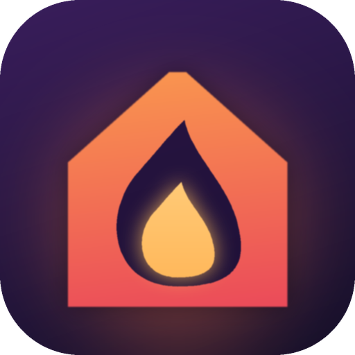

<p align="center"></p>

# Hearth

**A home dashboard that gives old iPads (and other old tablets) a second life.**

Hearth turns a Windows PC into a small home server and an old iPad into a beautiful wall/kitchen dashboard: clock, weather, family calendar, a photo slideshow, and your media — movies, music, radio, TV, YouTube, Spotify, Google Photos, podcasts and even WhatsApp — all in plain, lightweight HTML that runs on **Safari 9 (iOS 9.3.5, iPad 2/3/mini 1)**.

No app store, no subscriptions, no cloud of ours. Everything runs on your own PC.

## Features

| | |
|---|---|
| **Home screen** | Big clock, weather and 5-day forecast, today/tomorrow agenda, full-screen photo slideshow background, "on this day" memories. Three styles: *Photos*, *Glass* and *Dark*. |
| **Now playing** | One player for everything: radio, music, podcasts, Spotify, live TV and video. TV/video can be embedded on the home screen (S/M/L), as a mini window, or full screen. |
| **Watch** | *Movies* (Plex-like library: each folder is analysed, the real movie file is picked and samples/trailers/junk are ignored; posters & details from iTunes, Wikipedia, optionally TMDB/OMDb), *TV* (free channels from iptv-org by country and language) and *YouTube* (search, channels, 360p instantly or HD prepared on the PC with yt-dlp). |
| **Listen** | *Music* (reads MP3/M4A tags: artists, albums, genres, decades, songs, folders), *Spotify* (free account, played in a hidden Edge on the PC and streamed to the tablet), *Radio* (radio-browser.info, by country, language and genre; fast server-side cache), *Podcasts*. |
| **Photos** | Your PC photo folders as a timeline, viewer and uploads from the iPad. Nightly sync of recent photos and chosen albums from **Google Photos** (uses the PC's Edge session). |
| **Calendar** | Your Google calendars (read through the PC's Google session, no setup) or any iCal/public calendar link, each with its own colour. |
| **Messages** | Read and reply to **WhatsApp** chats (WhatsApp Web in the PC's Edge), with new-message toasts on the home screen. |
| **Documents** | A simple WordPad-like word processor (great for kids learning to type): fonts, colours, lists, tables, images from the iPad's camera roll, print, save as .html/.doc/.txt. |
| **Web** | Show any web page (or part of it) from the PC on the tablet as a live image you can tap — e.g. **Google Home** to control lights and cameras. |
| **Kids mode** | A PIN-protected mode that only shows the apps you choose. |
| **Languages** | Català, Español, English, Português, Français (easy to add more: copy `www/lang/en.js`). |

## Requirements

- A Windows 10/11 PC that stays on (uses the PowerShell and .NET Framework already included in Windows — nothing to install).
- Microsoft Edge (already in Windows) for Spotify, Google Photos/Calendar/Home and WhatsApp.
- Optional: **ffmpeg** and **yt-dlp** (the installer downloads them for you), **VB-Cable** (free virtual audio cable) to hear Spotify on the tablet.
- Any tablet/phone browser on the same Wi-Fi. Designed for and tested against iOS 9 Safari (ES5 only, no modern CSS).

## Install

1. Download this repository (green **Code** button ▸ *Download ZIP*) and unzip it somewhere permanent, e.g. `C:\Hearth`.
2. Double-click **`Instal-la Hearth.bat`** and accept the Windows prompt. It sets up the network permission and firewall, starts Hearth automatically when you log in, creates desktop icons and downloads the optional tools.
3. A welcome page opens with a **QR code** and the address **`http://hearth.local:8080`**. Open it on the iPad (Safari ▸ Share ▸ *Add to Home Screen*). The `hearth.local` name keeps working even if the PC's IP address changes.
4. Choose your folders, city and language in **Settings**.

To remove it, run **`Desinstal-la Hearth.bat`** (your photos, music and data are not touched).

## How it works

```
iPad (Safari 9)  ──HTTP──▶  Windows PC: servidor.ps1 compiles the C# server (*.cs) with Add-Type
                                ├── www/            the HTML apps (shell + one page per app, iframes)
                                ├── dades/          your settings, caches and indexes (not in git)
                                └── hidden Edge     Spotify / Google / WhatsApp via the DevTools protocol
```

- Pure HTML/CSS/ES5 on the client, no frameworks, no build step. Only two app pages are kept in memory at a time.
- The C# server is a few files compiled at start-up by PowerShell (`HttpListener`, no external dependencies). It also announces itself on the LAN as `hearth.local` (mDNS).

## Disclaimer

Hearth is a personal hobby project for use **at home with your own accounts**. It is not affiliated with Apple, Google, YouTube, Spotify, Meta/WhatsApp or any broadcaster. Some features automate the web versions of third-party services or use tools like yt-dlp; this may go against those services' terms of use, and you are responsible for how you use it. Spotify and WhatsApp only start when you open them. TV and radio streams come from public directories of free-to-air streams (iptv-org, radio-browser.info).

## License

[MIT](LICENSE)
