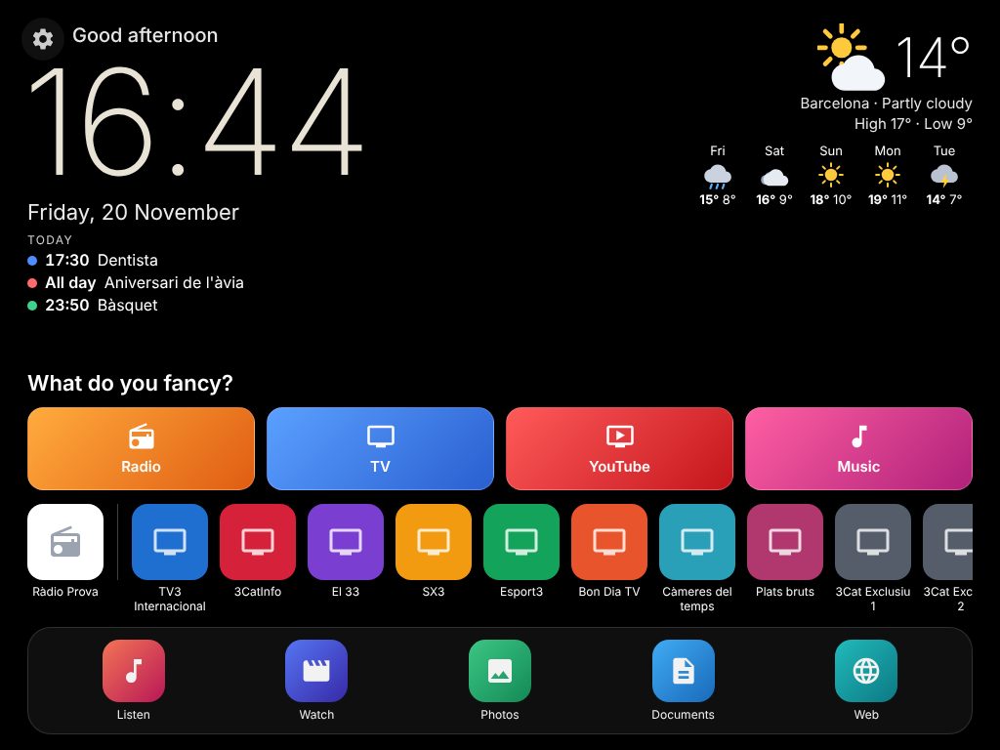
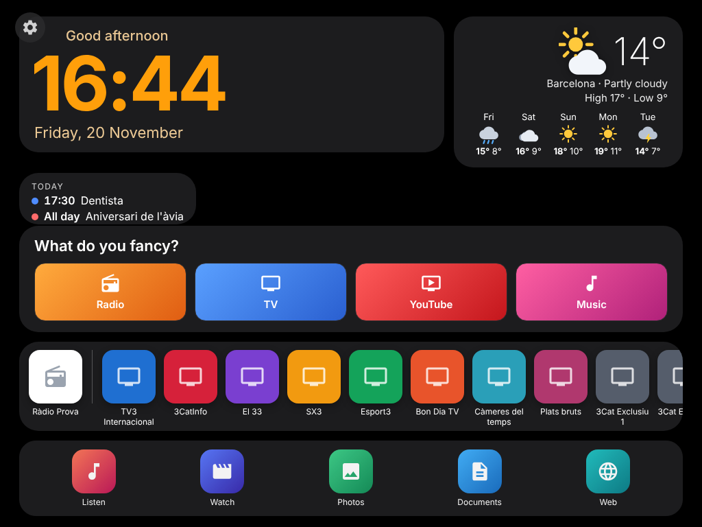
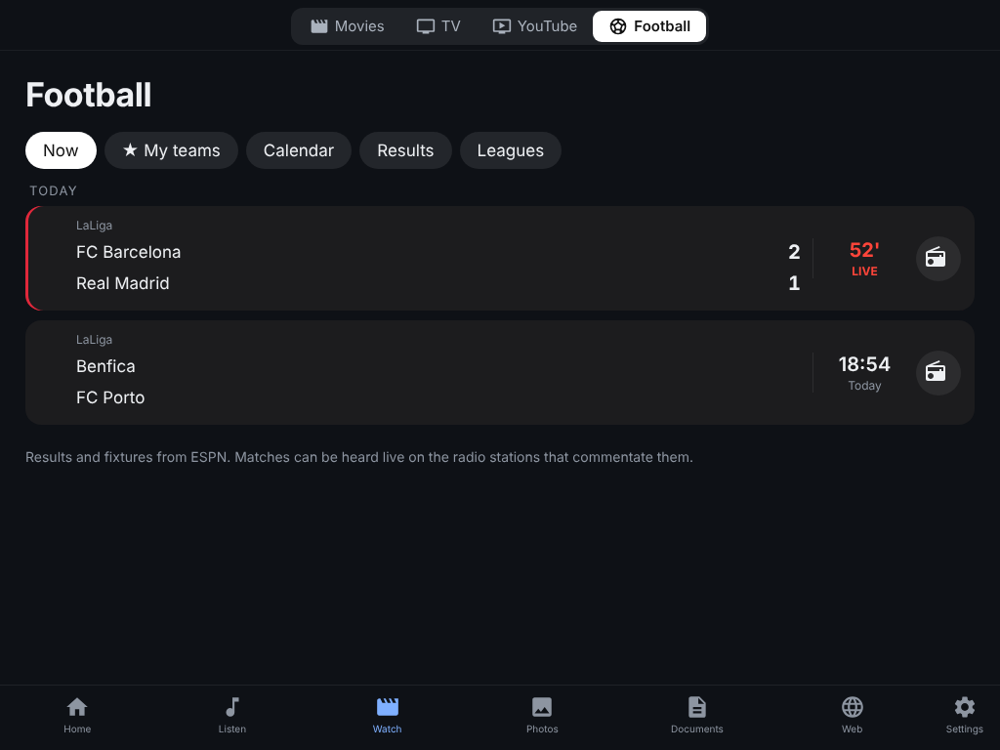
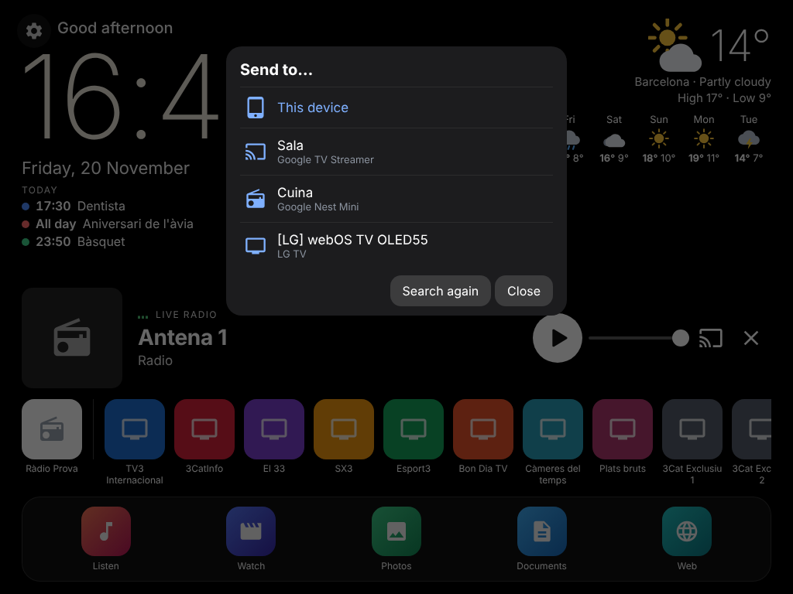
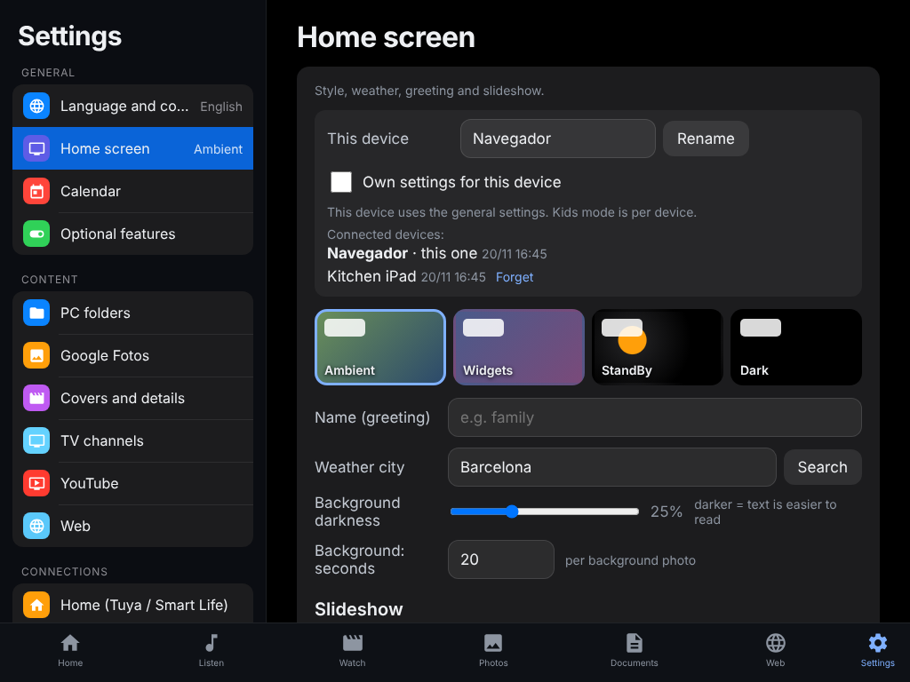

<p align="center"></p>

<h1 align="center">Hearth</h1>

<p align="center"><b>Give your old iPad a second life as a home dashboard.</b><br>
Photos, YouTube, radio, TV, Spotify, movies, music, calendar and football, served from a Windows PC at home.<br>
Runs on <b>Safari 9 (iOS 9.3.5)</b>: iPad 2, iPad 3, iPad mini 1 and any newer tablet, phone, PC or TV browser — even an iPod touch 4 gets a simplified home screen.</p>

<p align="center">
  <a href="https://github.com/sergi-bermudez/Hearth-Dashboard/releases/latest"><b>⬇ Download the latest release</b></a>
</p>

<p align="center">
  
  
</p>

## Why

Millions of perfectly good iPads are stuck on iOS 9 or 10: the App Store no longer has apps for them and most websites don't load. Hearth moves the heavy work to a PC you already have, and gives the tablet a fast, simple interface written in plain HTML and ES5 that old Safari handles well.

No app store, no subscription, no account with us, no cloud. Everything runs on your own PC and your home Wi-Fi.

## Features

| | |
|---|---|
| **Home screen** | Big clock, weather and forecast, today's agenda, a photo background with "on this day" memories, and what's playing. Four styles inspired by the best: **Ambient** (Nest Hub), **Widgets** (iPadOS), **StandBy** (iPhone) and **Dark**. |
| **Slideshow** | Full-screen photo frame when nobody touches the tablet: **Classic**, **Ken Burns**, **Magazine** (three photos from the same day or trip) and **Whole photo** (no cropping, blurred background). |
| **Watch** | **Movies**: a Netflix/Plex-style library with a featured movie, sliding rows (continue watching, recently added, genres) and search. It finds every video in every folder, skips samples and short extras, and gets covers and details from TMDB, iTunes, Wikipedia and Wikidata in several languages. Doubtful or unrecognised titles are flagged under **To review** with the closest matches to confirm; any movie can be searched again and a wrong pick undone. **TV**: free-to-air channels by country and language. **YouTube**: search, channels and HD, converted by the PC so even iOS 9 can play it. |
| **Football** | Live scores, fixtures and results for your leagues, plus any team you add (its own schedule in every competition), where each match is broadcast, and a radio button to listen to the commentary on Catalunya Ràdio, RAC1, SER, COPE, Antena 1, TSF… |
| **Listen** | **Music** (your MP3/M4A library by artist, album, genre and decade), **Radio** (thousands of stations from radio-browser.info), **Podcasts**, and **Spotify** (optional: plays in Edge on the PC and streams to the tablet, with a home like the app: shortcuts, recently played, your playlists, albums and artists). |
| **Cast** | Send whatever is playing to a **Chromecast, Google TV, Google Nest** speaker, a **DLNA TV (LG, Samsung, Sony…)** or **other Hearth screens** — one, several or all of them in sync, with a per-device delay. Incoming sends start by themselves after a few seconds. **Show Hearth on the TV** projects the PC to a Miracast TV in TV mode (bigger layout, remote-control arrows). |
| **Photos** | Your PC photo folders as a timeline, plus recent photos and chosen albums from **Google Photos**, either copied to the PC nightly or **on demand** (each photo downloaded when first viewed, 1 GB cache). Each device chooses which folders and albums it shows. |
| **Calendar** | Your Google calendars or any iCal link, each in its own colour. |
| **Web browser** | Browse any modern website from an old iPad: Edge on the PC opens the page at the tablet's screen size and sends back a picture after every tap, scroll or text you type — with an address bar, back/forward and reload like a normal browser. |
| **Smart home** | Tuya / Smart Life lights, plugs and scenes, and any web page from the PC (e.g. Google Home or a camera) shown live on the tablet. |
| **Shopping** | Shared shopping list picked like a restaurant till: products by category with photos, prices and current deals, read nightly from your supermarkets' websites (any shop with an online store, in any country — just add its address). Pick a concept ("eggs") and see the cheapest similar product and where; kg or pieces with +/−; the list grouped by shop; fill the shop's online cart from the PC; send the whole list or one shop's list by WhatsApp (to yourself first). |
| **Messages** | Optional WhatsApp reading and replying, with a red badge for new messages. |
| **Documents** | A simple WordPad-style editor, great for kids learning to type, with photos from the tablet's camera roll. |
| **Family** | **Kids mode** with a PIN and only the apps you choose. **This device** settings: name, keep the screen always on, dock at the bottom or on the right (automatic on wide screens), light mode for old iPads, TV mode, sound delay and photo folders; every device can also have its own style, slideshow and night mode. |
| **Installable** | Add to Home Screen on iPad/iPhone for full screen; installable PWA on Android and desktop. Five languages: English, Català, Español, Português, Français. |
| **Reliable at home** | Checks GitHub every hour and updates itself at night (it compiles the new version first and rolls back if it doesn't start). Pages always load matching files after an update and repair themselves if a device's saved data breaks. Missed nightly jobs run when the PC wakes up, the PC is kept awake while a screen is connected, and if the server stops answering the screens say so and dim what needs it. |

<p align="center">
  
  
</p>
<p align="center">
  
</p>

## Requirements

- A **Windows 10/11 PC** that stays on. Hearth uses the PowerShell and .NET Framework that Windows already includes, so there is nothing to install.
- **Microsoft Edge**, which comes with Windows, for Google Photos/Calendar, Spotify and WhatsApp.
- Hearth downloads the optional tools for you: the installer fetches **ffmpeg** and **yt-dlp**, and **Deno** is fetched the first time you use YouTube. They are used for YouTube and video conversion. For Spotify you also need **VB-Cable**, a free virtual audio cable.
- Any tablet or phone browser on the same Wi-Fi.

## Install

1. Download the zip from the [latest release](https://github.com/sergi-bermudez/Hearth-Dashboard/releases/latest) and unzip it somewhere permanent, e.g. `C:\Hearth`.
2. Double-click **`Instal-la Hearth.bat`** and accept the Windows prompt. It sets up the firewall, starts Hearth when you log in and downloads the optional tools.
3. A welcome page opens with a **QR code** and the address **`http://hearth.local:8080`**. Open it on the tablet, then in Safari tap Share ▸ *Add to Home Screen*. The `hearth.local` address keeps working even if the PC's IP changes.
4. Pick your folders, city and language in **Settings**.

Updates install themselves from then on. You can also update by hand in Settings ▸ Updates. To remove Hearth, run **`Desinstal-la Hearth.bat`**: your photos, music and data are not touched.

## How it works

```
Tablet (Safari 9+) ──HTTP──▶ Windows PC: servidor.ps1 compiles the C# server (*.cs) with Add-Type
                               ├── www/          the HTML apps (one shell + one page per app)
                               ├── dades/        your settings, caches and indexes (not in git)
                               ├── eines/        installer, updater, ffmpeg / yt-dlp / Deno
                               └── hidden Edge   Google, Spotify and WhatsApp via the DevTools protocol
```

- **Client:** plain HTML, CSS and ES5, with no framework and no build step. It is tested against iOS 9 Safari.
- **Server:** a few C# 5 files compiled at start-up by PowerShell (`HttpListener`, no NuGet packages). It announces itself as `hearth.local` over mDNS.
- **Video:** the PC converts video and radio to HLS with ffmpeg, so old iPads can play almost anything.
- **Casting:** Chromecast devices use the Cast v2 protocol (mDNS discovery, TLS on port 8009); TVs use UPnP/DLNA (SSDP discovery and AVTransport).

## Contributing

Issues and pull requests are welcome, especially from people reviving other old devices. To add a language, copy `www/lang/en.js` and translate the values.

## Disclaimer

Hearth is a personal hobby project for use **at home with your own accounts**. It is not affiliated with Apple, Google, YouTube, Spotify, Meta/WhatsApp, ESPN or any broadcaster. Some features automate the web versions of third-party services or use tools such as yt-dlp. This may go against those services' terms of use, and you are responsible for how you use it. Spotify and WhatsApp are off by default. TV and radio streams come from public directories of free-to-air streams (iptv-org, radio-browser.info).

## License

[MIT](LICENSE)

Shopping-list icons are [Twemoji](https://github.com/jdecked/twemoji) graphics (© Twitter, Inc. and other contributors, [CC-BY 4.0](https://creativecommons.org/licenses/by/4.0/)), downloaded once by the server and cached.
